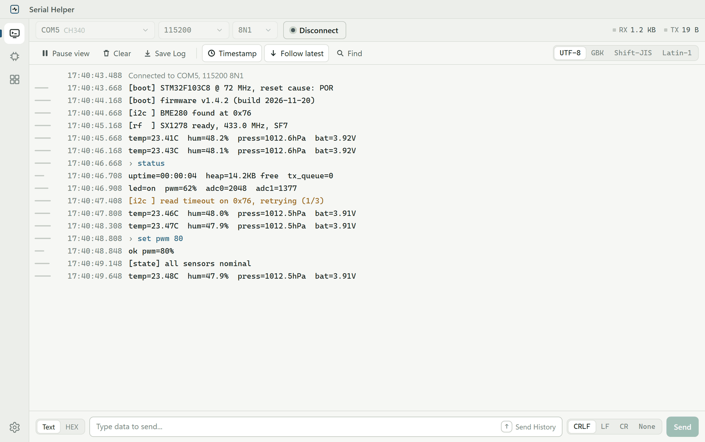
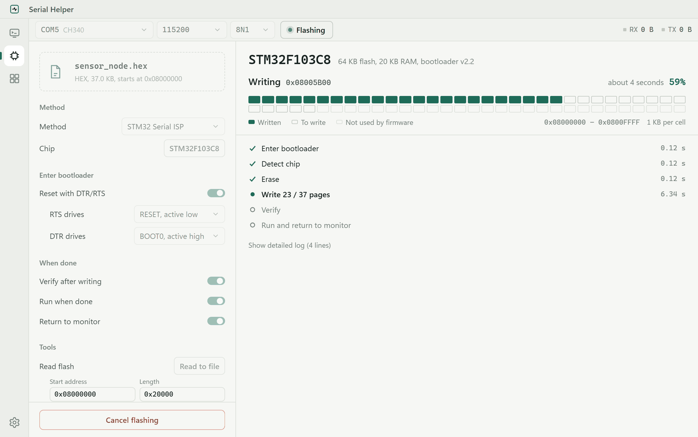
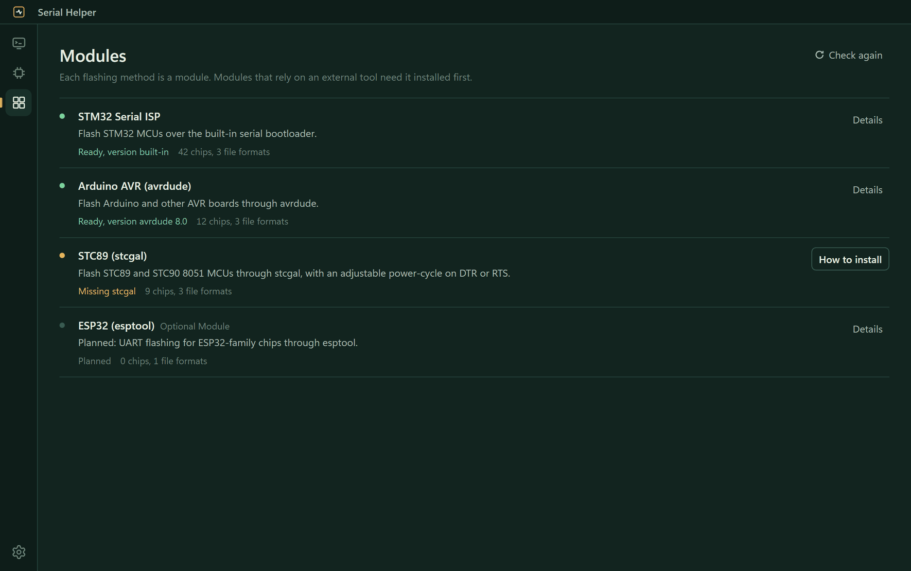
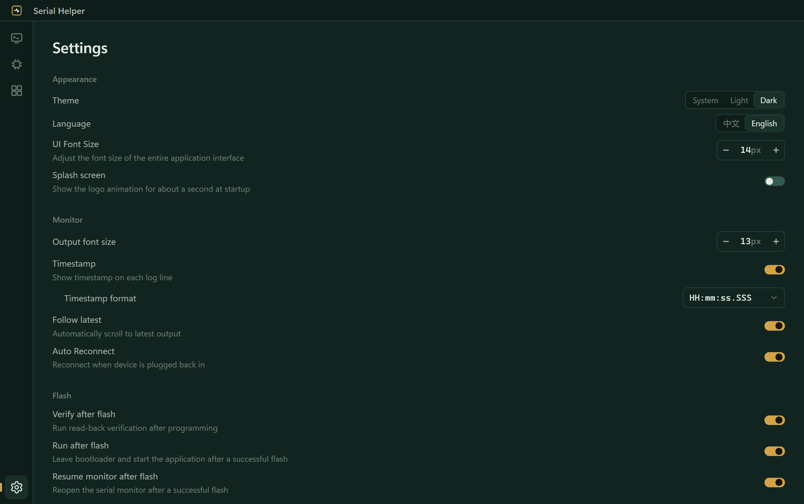

<div align="center">


# Serial Helper

**A serial monitor and firmware flasher in one window.**

[简体中文](README.md) · English

[](https://github.com/Stewitch/serial-helper/releases/latest)
[](https://github.com/Stewitch/serial-helper/releases)


<br />

<picture>
  <source media="(prefers-color-scheme: dark)" srcset="docs/images/monitor-dark-en.png" />
  
</picture>

</div>

<br />

A typical microcontroller loop looks like this: watch the log in a serial terminal, close the port, switch to a flashing tool, download the firmware, then go back and reopen the port. Serial Helper folds those steps into one click. It releases the port, enters the bootloader, writes, verifies and resets the chip, then returns to the monitor and keeps receiving.

## Features

<table>
<tr>
<td width="50%" valign="top">

### 📟 Serial monitor

- Send as text or HEX, with CRLF, LF, CR or no line ending
- Receive as UTF-8, GBK, Shift-JIS or Latin-1; multi-byte characters split across reads stay intact
- Millisecond timestamp on every line, plus find in output
- Pausing the view keeps receiving in the background; jump to latest when you resume
- Waits when the device is unplugged and reconnects when it comes back
- Virtualized output keeps 50,000 lines by default; logs can be saved to a file

</td>
<td width="50%" valign="top">

### ⚡ Firmware flashing

- Loads `.hex`, `.ihx` and `.bin`, or drop the file on the window
- Frees the port before flashing and resumes the monitor afterwards
- A flash page map shows write progress and time remaining
- Reloads the firmware when the file is rebuilt
- Configurable DTR / RTS lines to enter the bootloader and reset
- Read chip info, mass erase, and read flash back to a file

</td>
</tr>
</table>

<div align="center">
<picture>
  <source media="(prefers-color-scheme: dark)" srcset="docs/images/flash-dark-en.png" />
  
</picture>
</div>

## Supported chips

Each flashing method is a module. The Modules page checks for dependencies and reuses working tools. On 64-bit x86 Windows 10 / 11, click **Install dependencies** when AVR or STC89 needs tools. Serial Helper downloads and verifies pinned versions from upstream and installs them in your local app data folder. Installing requires neither a system `PATH` change nor an app restart.

| Module | Chips | Requires | Status |
| :-- | :-- | :-- | :-- |
| **STM32 Serial ISP** | F0 / F1 / F2 / F3 / F4 / F7 / G0 / G4 / H7 / L0 / L4 / WB, 42 parts, auto-detected | Nothing; built-in AN3155 implementation | ✅ Available |
| **Arduino AVR** | 12 parts including ATmega328P, ATmega2560, ATmega32U4, ATtiny85 | [avrdude](https://github.com/avrdudes/avrdude/releases) | ✅ Available |
| **STC89 / STC90** | 9 parts including STC89C51RC, STC89C52RC, STC89C516RD+, STC90C52RC | Python 3 + [stcgal](https://github.com/grigorig/stcgal) | ✅ Available |
| **ESP32** | ESP32 family | Python 3 + esptool | 🚧 Planned |

> [!TIP]
> The STC89 module can power-cycle the MCU through DTR or RTS, with an adjustable off level and duration. On some boards DTR switches the MCU's power directly, and the official STC-ISP tool often fails to connect to them. Here you can match the setting to how your board is wired.

<div align="center">

</div>

## Download

Get the latest installer (`.msi` or `-setup.exe`) from [Releases](https://github.com/Stewitch/serial-helper/releases/latest).

> [!NOTE]
> Serial Helper is developed and tested on Windows 10 and 11 only. It is built on Tauri, so macOS and Linux builds should be possible, but they have not been tried.
>
> The installer is not code-signed. On first launch Windows SmartScreen may warn about an unknown publisher; choose "Run anyway".

## Usage

1. Plug in a USB serial adapter, pick the port and baud rate in the top toolbar, and click Connect.
2. Send and receive on the Monitor page.
3. On the Flash page, pick a method, drop in a firmware file, and click Start flashing.

<details>
<summary><b>STM32 auto-boot wiring (DTR / RTS)</b></summary>

<br />

The default assumes a one-click download circuit where DTR drives BOOT0 and RTS drives NRST. When flashing, the app raises BOOT0 and resets the chip into the system bootloader. When it finishes, it lowers BOOT0 and resets again so the new program runs.

If your board is wired differently, set the function and active level of DTR and RTS under "Enter bootloader". Without an auto-boot circuit, turn the option off, tie BOOT0 high by hand and press reset.

</details>

## Settings

<div align="center">

</div>

You can change the theme (light, dark or system), the interface language (简体中文 or English), the UI font size, the default serial parameters for new connections, and whether to verify, run and resume the monitor after flashing.

## Building from source

<details>
<summary>Expand</summary>

<br />

**Requirements**

- [Node.js](https://nodejs.org/) 18 or later
- [Rust](https://www.rust-lang.org/tools/install) stable
- Tauri 2 [prerequisites](https://v2.tauri.app/start/prerequisites/) (on Windows: MSVC build tools and WebView2)

**Run in development**

```powershell
npm install
npm run tauri dev
```

**Build installers**

```powershell
npm run build:release
```

Installers are written to `src-tauri/target/release/bundle/`.

**Cut a new version**

`npm version` keeps the version in `package.json`, `Cargo.toml` and `tauri.conf.json` in sync:

```powershell
npm version patch
```

Create a release on GitHub, choose or create a `vX.Y.Z` tag matching the target commit's version, then write the title and release notes and select **Publish release**. You can leave the attachments empty. GitHub Actions builds the Windows x64 MSI and NSIS installers and attaches them to the release. To fill in missing installers for an existing release, select **Actions → Windows Release → Run workflow** and enter its tag.

</details>

## Tech stack

| Layer | Uses |
| :-- | :-- |
| Desktop shell | [Tauri 2](https://v2.tauri.app/) |
| Backend | Rust, [serialport](https://crates.io/crates/serialport), tokio |
| Frontend | React 18, TypeScript, Vite, Tailwind CSS |
| State and UI | Zustand, Radix UI, TanStack Virtual, i18next |

## Acknowledgements

- [stcgal](https://github.com/grigorig/stcgal): ISP tool for STC microcontrollers
- [AVRDUDE](https://github.com/avrdudes/avrdude): AVR programmer
- [stm32flash](https://sourceforge.net/projects/stm32flash/): reference for the STM32 serial bootloader protocol

<div align="right">

[Back to top ↑](#serial-helper)

</div>
