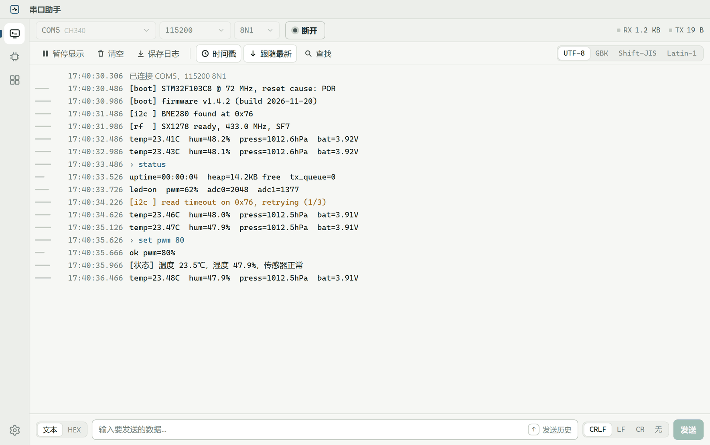
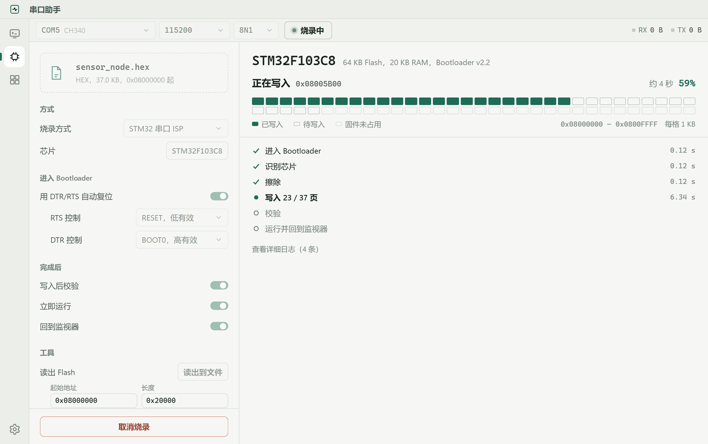
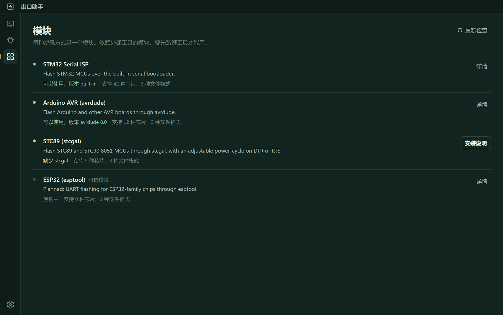
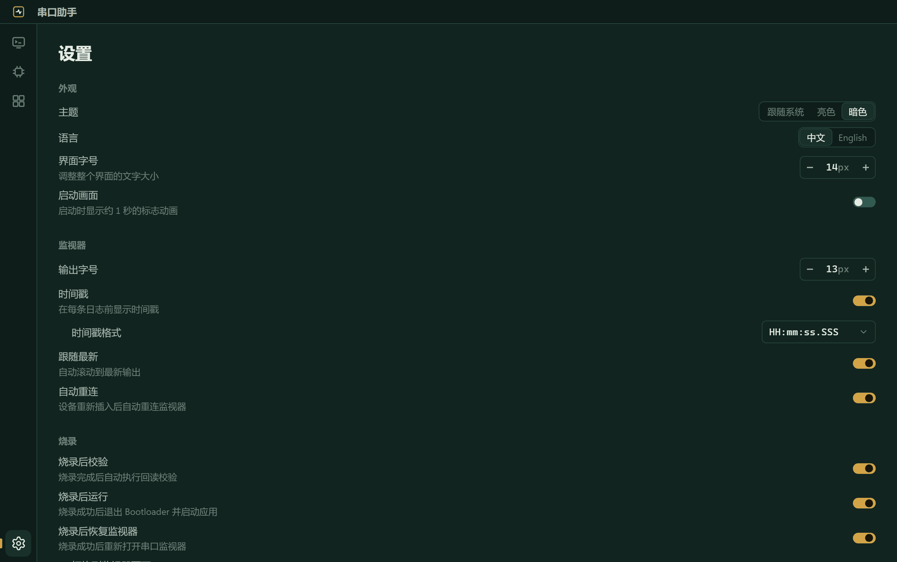

<div align="center">


# 串口助手

**串口监视与固件烧录，放在同一个窗口里。**

简体中文 · [English](README.en.md)

[](https://github.com/Stewitch/serial-helper/releases/latest)
[](https://github.com/Stewitch/serial-helper/releases)


<br />

<picture>
  <source media="(prefers-color-scheme: dark)" srcset="docs/images/monitor-dark-zh.png" />
  
</picture>

</div>

<br />

调单片机时，常见的流程是：串口助手里看日志，关掉串口，切到烧录工具下载固件，再回来重新打开串口。串口助手把这几步合在一起：点一下烧录，它会自己让出串口、进入 Bootloader、写入、校验、复位，然后回到监视器继续接收数据。

## 功能

<table>
<tr>
<td width="50%" valign="top">

### 📟 串口监视

- 文本 / HEX 两种发送格式，行尾可选 CRLF、LF、CR 或不加
- 接收编码支持 UTF-8、GBK、Shift-JIS、Latin-1，多字节字符跨包不会乱码
- 每行带毫秒时间戳，可在输出中查找
- 暂停视图时后台继续接收，恢复后一键跳到最新
- 设备拔出后自动等待，插回自动重连
- 虚拟列表渲染，默认保留 5 万行，日志可导出

</td>
<td width="50%" valign="top">

### ⚡ 固件烧录

- 支持 `.hex` / `.ihx` / `.bin`，可直接拖进窗口
- 烧录前自动释放串口，完成后自动恢复监视
- Flash 页面图实时显示写入进度和剩余时间
- 固件文件重新编译后自动重新加载
- 可配置 DTR / RTS 自动进入 Bootloader 和复位
- 读芯片信息、整片擦除、回读 Flash 到文件

</td>
</tr>
</table>

<div align="center">
<picture>
  <source media="(prefers-color-scheme: dark)" srcset="docs/images/flash-dark-zh.png" />
  
</picture>
</div>

## 支持的芯片

每种烧录方式是一个模块。「模块」页会检查依赖并复用可用的工具。在 Windows 10 / 11 x64 上，AVR 或 STC89 缺少依赖时，可以点击「安装依赖」。应用从上游下载并校验固定版本，安装到当前用户的应用数据目录，无需修改系统 `PATH` 或重启。

| 模块 | 芯片 | 依赖 | 状态 |
| :-- | :-- | :-- | :-- |
| **STM32 串口 ISP** | F0 / F1 / F2 / F3 / F4 / F7 / G0 / G4 / H7 / L0 / L4 / WB，共 42 个型号，自动识别 | 无，内置 AN3155 协议实现 | ✅ 可用 |
| **Arduino AVR** | ATmega328P、ATmega2560、ATmega32U4、ATtiny85 等 12 个型号 | [avrdude](https://github.com/avrdudes/avrdude/releases) | ✅ 可用 |
| **STC89 / STC90** | STC89C51RC、STC89C52RC、STC89C516RD+、STC90C52RC 等 9 个型号 | Python 3 + [stcgal](https://github.com/grigorig/stcgal) | ✅ 可用 |
| **ESP32** | ESP32 系列 | Python 3 + esptool | 🚧 计划中 |

> [!TIP]
> STC89 模块可以用 DTR 或 RTS 给单片机断电重启，断电电平和时长都能调。部分开发板的 DTR 直接控制 MCU 供电，官方 STC-ISP 在这类板子上容易连不上，这里可以按板子实际接法设置。

<div align="center">

</div>

## 下载安装

到 [Releases](https://github.com/Stewitch/serial-helper/releases/latest) 下载最新版本的安装包（`.msi` 或 `-setup.exe`），安装后即可使用。

> [!NOTE]
> 目前只在 Windows 10 / 11 上开发和测试。程序基于 Tauri，理论上可以在 macOS 和 Linux 上构建，但还没有验证过。
>
> 安装包未做代码签名，首次运行时 Windows SmartScreen 可能会提示「未知发布者」，选择「仍要运行」即可。

## 使用

1. 插上 USB 转串口设备，在顶部工具栏选择端口和波特率，点「连接」。
2. 在「监视器」页收发数据。
3. 切到「烧录」页，选择烧录方式，拖入固件文件，点「开始烧录」。

<details>
<summary><b>STM32 自动下载接线（DTR / RTS）</b></summary>

<br />

默认配置假设开发板的一键下载电路是：DTR 控制 BOOT0，RTS 控制 NRST。烧录时程序拉高 BOOT0、复位芯片进入系统 Bootloader，结束后拉低 BOOT0 再复位，让芯片运行新程序。

如果你的板子接法不同，可以在「进入 Bootloader」一栏分别设置 DTR、RTS 的功能和有效电平；没有自动下载电路时关闭这一项，手动把 BOOT0 接高再按复位。

</details>

## 设置

<div align="center">

</div>

可调整主题（浅色 / 深色 / 跟随系统）、界面语言（简体中文 / English）、界面字号、新连接的默认串口参数，以及烧录完成后是否校验、运行和恢复监视。

## 从源码构建

<details>
<summary>展开</summary>

<br />

**环境要求**

- [Node.js](https://nodejs.org/) 18 或更高
- [Rust](https://www.rust-lang.org/tools/install) stable
- Tauri 2 的[系统依赖](https://v2.tauri.app/start/prerequisites/)（Windows 上为 MSVC 生成工具和 WebView2）

**开发运行**

```powershell
npm install
npm run tauri dev
```

**打包发布**

```powershell
npm run build:release
```

安装包输出在 `src-tauri/target/release/bundle/`。

**发布新版本**

`npm version` 会同步 `package.json`、`Cargo.toml` 和 `tauri.conf.json` 中的版本号：

```powershell
npm version patch
```

推送指向包含发布工作流的提交的 `vX.Y.Z` 标签后，GitHub Actions 会构建 Windows x64 的 MSI 和 NSIS 安装包，并上传到该标签对应的 GitHub Release。工作流合入默认分支后，已有的远程标签可在 **Actions → Windows Release → Run workflow** 中手动构建。

</details>

## 技术栈

| 层 | 使用 |
| :-- | :-- |
| 桌面框架 | [Tauri 2](https://v2.tauri.app/) |
| 后端 | Rust、[serialport](https://crates.io/crates/serialport)、tokio |
| 前端 | React 18、TypeScript、Vite、Tailwind CSS |
| 状态与界面 | Zustand、Radix UI、TanStack Virtual、i18next |

## 致谢

- [stcgal](https://github.com/grigorig/stcgal)：STC 单片机 ISP 工具
- [AVRDUDE](https://github.com/avrdudes/avrdude)：AVR 烧录工具
- [stm32flash](https://sourceforge.net/projects/stm32flash/)：STM32 串口 Bootloader 协议实现的参考

<div align="right">

[回到顶部 ↑](#串口助手)

</div>
